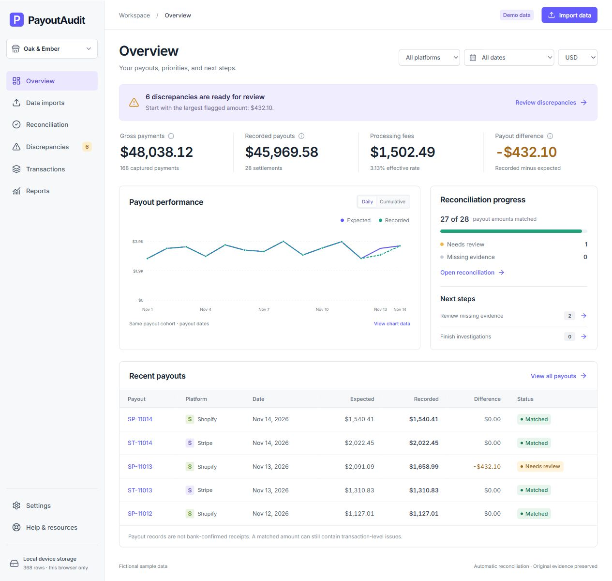
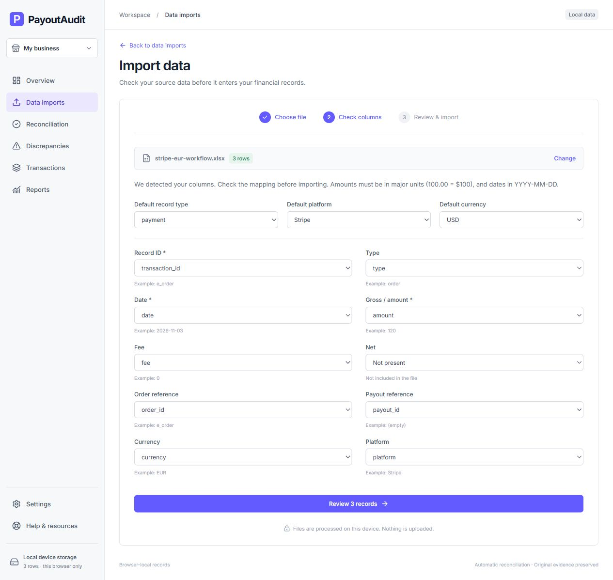
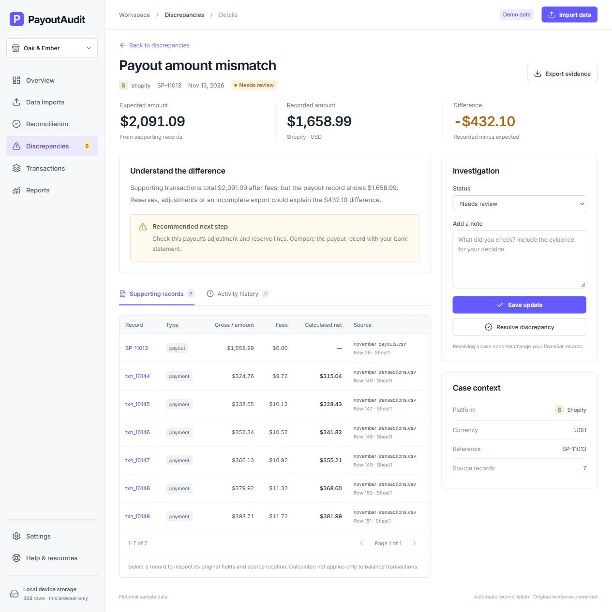

# PayoutAudit

PayoutAudit helps small online sellers understand how orders, payments, refunds, fees, and payouts fit together. Import spreadsheet exports, reconcile financial records, investigate differences using original evidence, and record how each issue was resolved.

Built with React and Vite, the application runs entirely in the browser. Local use requires no provider account connection, API key, or backend service. Its English interface organizes the work into **Data imports → Reconciliation → Discrepancies → Reports**, with an overview and a searchable transaction register.

[Open the hosted application](https://payoutaudit-oak-ember.humble-field-3507.chatgpt.site/) — access is limited by the existing private site's permissions.

## Main interface

The overview shows calculated totals, expected versus recorded payouts, reconciliation progress, and the next cases to review. The fictional Oak & Ember demo includes 368 source rows, 28 payouts, and six explainable discrepancies. Of those payouts, 27 match their supporting transaction amounts; one has a $432.10 shortfall in the imported payout record.



All screenshots are actual application captures using fictional demonstration or test records. The JPEG files are included in `docs/screenshots/` and referenced by relative paths, without local drive paths or temporary image URLs.

## Core features

| Feature | What it does |
|---|---|
| Guided CSV and Excel import | Reads `.csv` and `.xlsx`, recognizes common column aliases, previews sample values, and allows mapping corrections and worksheet selection. |
| Reliable reconciliation | Matches exact order and payout references within the same platform and currency, including partial captures, refunds, signed fees, and adjustments. |
| Explainable discrepancies | Detects duplicate identifiers, missing records, unusual fees, mismatched order totals, inconsistent net values, and payout differences. Each flag includes a possible explanation and a next step. |
| Original source evidence | Preserves imported fields, file names, worksheet names, and row locations in a read-only record inspector. |
| Investigation workflow | Prioritizes cases by flagged amount; supports Needs review, Investigating, and Resolved states, notes, resolution reasons, and activity history. |
| Financial analysis | Provides daily or cumulative payout charts, accessible chart data, platform fee breakdowns, and financial summaries. |
| Contextual exports | Exports payout/discrepancy views, filtered transactions, evidence, financial summaries, fee reports, and investigation history. |
| Practical navigation | Separate workspaces, search, filters, pagination, detail pages, keyboard access, and responsive mobile layouts. URLs retain view filters. |

Column recognition is a transparent alias-based aid, not an AI guarantee or a substitute for checking the preview. Matching does not guess links from similar amounts.

## Installation

### Prerequisites

- Node.js **22.12 or newer**, with npm. The locked Vite version also supports Node.js 20.19.x and later 20.x releases.
- A modern browser with JavaScript and local storage enabled.
- The project source, including `package.json` and `package-lock.json`.

### Start the application

1. Open a terminal in the application directory containing `package.json`.
2. Install the locked dependencies. This downloads packages into the local `node_modules` directory:

   ```sh
   npm ci
   ```

   **Success:** installation finishes without an error.

3. Start the development server:

   ```sh
   npm run dev
   ```

4. Open the localhost URL printed by Vite, normally `http://127.0.0.1:5173`.

   **Success:** the overview appears with the Oak & Ember demo and a **Demo data** badge. No financial accounts are accessed.

5. Stop the server with `Ctrl+C` when finished. It listens on `127.0.0.1` by default.

### Build and preview

```sh
npm run build
npm run preview
```

**Success:** Vite writes production assets to `dist/`, and the printed preview URL opens the app. `preview` checks the build locally. A static host can serve `dist/`; hash-based application routes do not require server-side page routing.

## Usage: from import to accounting handoff

### 1. Import and check your data

Open **Data imports**, then **New import**. Download the CSV template to try a complete matching order, payment, and payout.

Choose a CSV or Excel file, select its worksheet if applicable, and review the detected mappings. Confirm the record ID, date, amount, order reference, payout reference, platform, and currency. Defaults apply when their corresponding columns are absent. Missing fees default to zero, so verify that assumption before importing.



Select **Review records**, correct invalid rows or mappings, then choose **Import & reconcile**. Validation is atomic: a worksheet with invalid rows is not partially imported. An identical file and worksheet cannot be imported twice.

**Success:** the import confirmation appears, the file is listed in history, and **Review results** opens reconciliation. The first real import replaces fictional demo records and demo investigation notes. Subsequent imports add to the local workspace.

### 2. Review each payout

Open **Reconciliation**. Filter by platform, currency, date, or payout status. Select a payout to see expected and recorded amounts, their difference, the settlement calculation, supporting transactions, and related discrepancies.

**Success:** you can trace the expected payout to individual balance transactions. Returning to the list restores the search and status filters used to open the detail page.

### 3. Investigate and resolve discrepancies

Open **Discrepancies** and start with the largest flagged amount. Read its explanation and recommended next step. Select a supporting record to inspect original fields and its source location, or export the evidence.



Choose **Investigating**, enter what you checked, and select **Save update**. To resolve a case, choose a resolution reason and add a supporting note. A resolved case can be reopened with a new note. Cases resolved in this version are flagged for review again if their stored financial evidence changes.

**Success:** the decision appears in **Activity history** and survives a page refresh. Resolving a case does not edit original records or alter financial calculations.

### 4. Review and export reports

Open **Reports** and choose **Financial summary**, **Fees & refunds**, or **Investigation history**. Select the platform, currency, and date range. Use the contextual export button, or export the payout and discrepancy registers for your bookkeeper.

**Success:** the CSV contains the report being viewed. Financial values retain their signs, while formula-like text is escaped for spreadsheet safety. Investigation history uses update dates in UTC; financial activity and payouts use their own record dates.

## File format and limits

| Requirement | Accepted input |
|---|---|
| File types | `.csv` or `.xlsx`; save legacy `.xls` files as `.xlsx` first. |
| Size | Up to 8 MB and 20,000 rows per file; 30,000 rows per workspace. Browser storage can fill before these limits. |
| Headers | Unique column names. Excel headers must be in the first row. |
| Record types | `order`, `payment`, `refund`, `payout`, `adjustment`; aliases such as `charge` and `sale` are recognized. |
| Dates | ISO `YYYY-MM-DD`, such as `2026-11-01`. |
| Amounts | Major currency units, decimal point, at most two decimal places: `100.00` means 100 units, not 100 cents. |
| Currencies | USD, EUR, GBP, CAD, and AUD, analyzed separately. |
| References | Stable record IDs and exact order/payout references for meaningful matching. |

A minimal matching CSV is:

```csv
id,type,date,amount,fee,net,order_id,payout_id,currency,platform
order_101,order,2026-11-01,100.00,0.00,,order_101,,USD,Shopify
txn_101,payment,2026-11-01,100.00,3.20,96.80,order_101,po_101,USD,Shopify
po_101,payout,2026-11-03,96.80,0.00,,,po_101,USD,Shopify
```

Importing this example produces a matched payout of **$96.80**. XLSX formula cells are rejected; paste values before importing. A provider export may require mapping or restructuring. Shopify line-item order exports can repeat order IDs: PayoutAudit flags repeated identities and counts only the first total rather than treating each line item as an independent order.

## Financial calculation rules

- Money is calculated in integer cents. Each record is limited to 100 million major currency units; workspace limits keep aggregates within JavaScript's safe integer range.
- Orders match captures by exact platform, currency, and order reference. Multiple captures are added; refunds do not erase gross captures.
- **Expected payout = linked signed payments + refunds + adjustments − signed fees.** Refund amounts normalize negative; fee credits remain negative.
- Imported net is checked against gross minus fees. A conflicting net is flagged and does not replace the calculated settlement amount.
- Payout matching uses the entire imported history before view date filtering. A payout without supporting transactions stays **Missing evidence**, not a false match.
- Duplicate identities are scoped by platform, currency, type, and ID. Only the first occurrence contributes to totals; excluded copies remain available in discrepancy evidence.
- Fee review uses configurable baseline and tolerance values in **Settings**. The default 2.9% + 0.30 with 0.50 tolerance is illustrative, not a provider pricing promise.
- Activity and payout totals can represent different transactions because settlement timing differs. Opposing payout differences can offset in a signed total; reconciliation also shows absolute gaps.
- Flags are review signals, not confirmed losses. Flagged amounts may overlap. An amount-matched payout can contain transaction-level issues, and a payout record is not independent proof of bank receipt.

## Privacy, storage, and limitations

Files are parsed on the device. Records, raw evidence, import history, rules, and notes are saved in versioned browser `localStorage`. PayoutAudit does not upload those financial records, provide cloud backups, or synchronize across devices or browser profiles. Anyone with access to the browser profile can view the workspace. Normal hosting and font requests may still use the network.

Clearing browser data removes the local workspace. Export reports and evidence for retention. Storage errors leave the previous saved workspace unchanged. **Settings → Restore demo** and **Start clean** replace local records and notes after explicit confirmation.

This version does not provide live provider synchronization, bank-feed verification, foreign-exchange conversion, fuzzy matching, automatic allocation of manual payouts, tax filing, or multi-user collaboration.

## Development and verification

Paths below are relative to the application directory.

| Path | Purpose |
|---|---|
| `src/engine.js` | Integer-cent reconciliation and financial summaries. |
| `src/importer.js` | CSV/XLSX parsing, column aliases, validation, and safe CSV exports. |
| `src/workspace.js` | Persistence, case status, evidence signatures, and routing. |
| `src/pages/` | Overview, imports, reconciliation, discrepancies, transactions, reports, settings, and help. |
| `src/ui.jsx`, `src/charts.jsx`, `src/v2.css` | Shared components, financial charts, and responsive styling. |
| `tests/` | Financial and workflow regression tests. |
| `docs/screenshots/` | Repository-hosted images embedded in this README. |

```sh
npm test
npm run build
```

**Success:** all tests pass and the production build completes. At the end of this development session, 19 automated tests passed. Browser checks covered CSV/Excel imports, invalid-row and duplicate prevention, currency separation, evidence inspection, case updates/resolution/reopening, refresh persistence, exports, keyboard navigation, and desktop/mobile layouts. The final browser checks showed no application warnings or errors.

## Research and design

Public documentation for Stripe, Shopify Payments, QuickBooks, A2X, and Link My Books informed the product and redesign. Adopted patterns include payout-level drill-down, scoped exports, evidence-first review, and retained investigation history. The app is independent of these services.

See [initial product research](docs/RESEARCH.md) and [workflow redesign decisions](docs/REDESIGN.md) for sources and implementation choices.
